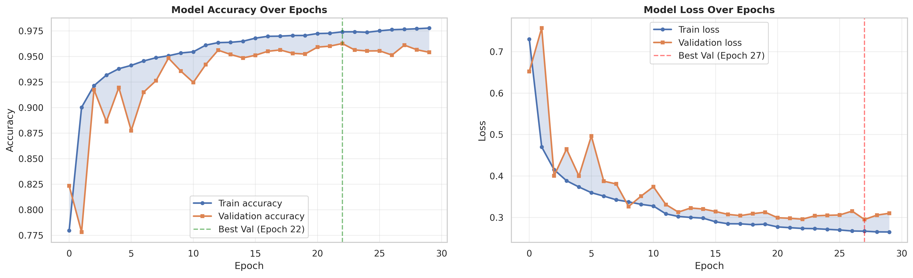
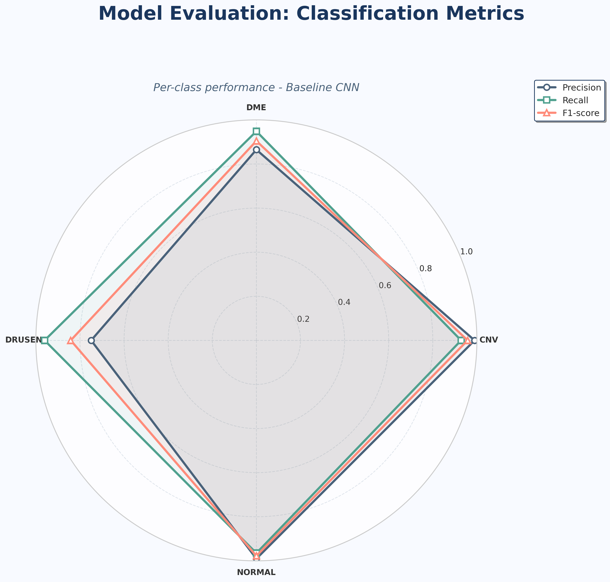
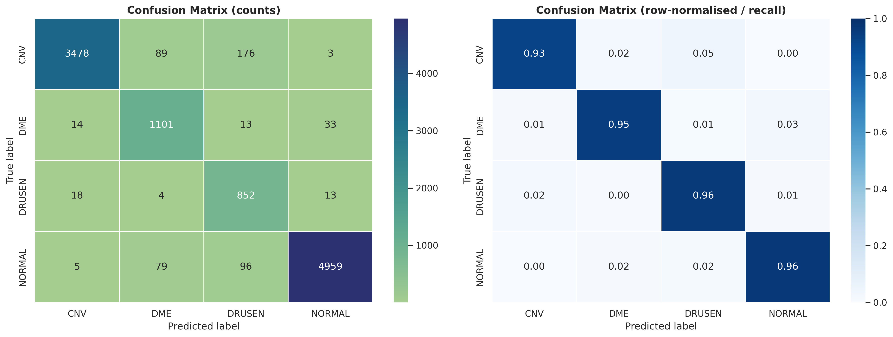
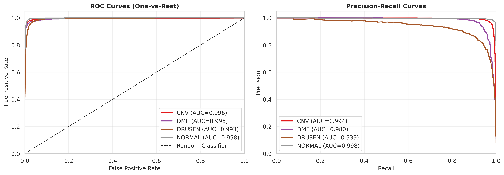

# CNN-Based Retinal OCT Classification: From-Scratch Baseline, ED126-A

Companion code, evaluation outputs, manuscript figures, and desktop inference prototype for **ED126-A**, a compact four-class convolutional neural network trained from scratch on labeled retinal Optical Coherence Tomography (OCT) images.

**Preprint:** [arXiv:2611.02114](https://arxiv.org/abs/2611.02114) · [DOI: 10.48550/arXiv.2611.02114](https://doi.org/10.48550/arXiv.2611.02114)  
**Journal manuscript:** Shkëlqim Sherifi, Festim Halili, and Merita Kasa-Halili. *CNN-Based Retinal OCT Classification: Research Gap Analysis and a From-Scratch Baseline, ED126-A.* Journal of Universal Computer Science (submitted).  
**Categories:** I.2.10, I.4.9, I.5.1, J.3 · **arXiv subjects:** cs.CV, cs.LG

This repository is a **research and demonstration resource**. It is not a clinically validated diagnostic system.

---

## Overview

Automated four-class OCT classification (CNV, DME, Drusen, Normal) remains difficult because diagnostically relevant patterns can be subtle and overlapping. Many published CNN results use heterogeneous protocols, which makes it hard to attribute gains to architecture, pretraining, or evaluation choices.

This work contributes:

1. A focused review of CNN-based retinal OCT classification and methodological issues for controlled benchmarking.
2. **ED126-A**, a purpose-built CNN trained from **random initialization** (no transfer learning, no ensembling) under a documented protocol on the Kermany labeled OCT dataset.

The goal is a **documented from-scratch reference baseline**, not a claim of state-of-the-art accuracy.

**Research questions**

- **RQ1:** Does a purpose-built CNN trained from scratch on the Kermany OCT dataset provide a useful empirical baseline for four-class OCT classification?
- **RQ2:** What are the class-conditional characteristics of ED126-A, and which classes drive residual error?

---

## Results (image-level held-out test set, *n* = 10,933)

Checkpoint selected by minimum validation loss at **epoch 27**. Reported metrics are **point estimates from a single training run**.

| Metric | Value |
|---|---|
| Accuracy | **95.03%** |
| Macro-F1 | 0.9205 |
| Weighted-F1 | 0.9521 |
| Total / trainable parameters | 1,241,380 / 1,239,460 |

Per-class operating-point metrics:

| Class | Sensitivity | Specificity | Precision | F1 |
|---|---|---|---|---|
| CNV | 0.9285 | 0.9949 | 0.9895 | 0.9580 |
| DME | 0.9483 | 0.9824 | 0.8649 | 0.9047 |
| Drusen | 0.9605 | 0.9716 | 0.7493 | 0.8419 |
| Normal | 0.9650 | 0.9915 | 0.9902 | 0.9774 |

**Principal limitation:** Drusen has high recall but low precision (F1 0.8419). Dominant error channels: **CNV → Drusen** (176) and **Normal → Drusen** (96). Of 1,137 Drusen-positive predictions, 285 (25.1%) were false positives.

One-vs-rest ROC-AUC was high for all classes (CNV 0.996, DME 0.996, Drusen 0.993, Normal 0.998). Average Precision was lower for Drusen (~0.94), so ROC-AUC alone does not capture the Drusen false-positive burden.

Best validation checkpoint (epoch 27): val loss 0.2953, val accuracy 0.9611, train accuracy 0.9766.

Metrics in `Outputs/` may differ slightly from the manuscript tables if they correspond to a different checkpoint or evaluation script; **use the manuscript / preprint numbers for citation**.

<p align="center">
  
</p>
<p align="center"><em>Fig. 13. Training and validation loss and accuracy across 30 epochs.</em></p>

<p align="center">
  
</p>
<p align="center"><em>Fig. 14. Class-wise precision, recall, and F1-score on the image-level held-out test set.</em></p>

<p align="center">
  
</p>
<p align="center"><em>Fig. 15. Confusion matrix of ED126-A on the image-level held-out test set.</em></p>

<p align="center">
  
</p>
<p align="center"><em>Fig. 23. One-vs-rest ROC and Precision–Recall curves for the four OCT classes.</em></p>

---

## Dataset

**Labeled Optical Coherence Tomography (OCT)** [Kermany et al., 2018].

- **Images:** 109,309 grayscale OCT B-scans
- **Classes:** CNV, DME, Drusen, Normal
- **Split (image-level, ~70/20/10):** 76,515 train / 21,861 val / 10,933 test
- **Patients:** 2,442 (Zhongshan Ophthalmic Center). Related images from the same patient **may appear in more than one split**. Reported scores are **not** patient-independent generalization.

**Sources**

- Kaggle: https://www.kaggle.com/datasets/anirudhcv/labeled-optical-coherence-tomography-oct
- Mendeley Data: https://doi.org/10.17632/rscbjbr9sj.3

Class counts are heterogeneous (coefficient of variation ≈ 0.65). Training used **balanced class weights**  
\(w_i = N_\text{total} / (N_\text{classes} \times N_i)\).

<p align="center">
  
</p>
<p align="center"><em>Fig. 1. Distribution of training and validation images across the four retinal OCT classes.</em></p>

<p align="center">
  
</p>
<p align="center"><em>Fig. 2. Class distribution of the retinal OCT dataset across CNV, DME, Drusen, and Normal.</em></p>

<p align="center">
  
</p>
<p align="center"><em>Fig. 3. Distribution of test-set images across the four retinal OCT classes.</em></p>

---

## Preprocessing and augmentation

All inputs are standardized to `224 × 224 × 1` grayscale and rescaled to `[0, 1]`. Training-time augmentation uses horizontal flip, small rotation, translation, zoom, and contrast perturbation. Vertical flip is excluded. Validation and test images are not augmented.

<p align="center">
  
</p>
<p align="center"><em>Fig. 4. Preprocessing and training-time augmentation pipeline for retinal OCT images.</em></p>

<p align="center">
  
</p>
<p align="center"><em>Fig. 5. Representative grayscale OCT images from the training set across the four diagnostic classes.</em></p>

<p align="center">
  
</p>
<p align="center"><em>Fig. 6. Representative training images after stochastic data augmentation.</em></p>

---

## Architecture (ED126-A)

Input: `224 × 224 × 1` grayscale. Four convolutional blocks (32 → 64 → 128 → 256 filters), each with two `3×3` same-padded convolutions, Batch Normalization, ReLU, and `2×2` stride-2 max pooling. No conv biases. Spatial dropout 0.25 after Block 4, Global Average Pooling, Dense(256, ReLU), dropout 0.40, softmax over 4 classes.

| Stage | Parameters | % of total |
|---|---|---|
| Preprocessing | 0 | 0.00% |
| Block 1 (32) | 9,760 | 0.79% |
| Block 2 (64) | 55,808 | 4.50% |
| Block 3 (128) | 222,208 | 17.90% |
| Block 4 (256) | 886,784 | 71.40% |
| Classification head | 66,820 | 5.38% |
| **Total** | **1,241,380** | **100%** |

Spatial size: 224 → 112 → 56 → 28 → 14.

<p align="center">
  
</p>
<p align="center"><em>Fig. 7. Overall architecture of the ED126-A convolutional neural network.</em></p>

<p align="center">
  
  
</p>
<p align="center"><em>Fig. 8–9. Convolutional blocks 1 (32 filters) and 2 (64 filters).</em></p>

<p align="center">
  
  
</p>
<p align="center"><em>Fig. 10–11. Convolutional blocks 3 (128 filters) and 4 (256 filters).</em></p>

<p align="center">
  
</p>
<p align="center"><em>Fig. 12. Classification head: global average pooling, dense layer, dropout, and four-class softmax.</em></p>

---

## Training protocol

| Setting | Value |
|---|---|
| Initialization | Random (from scratch) |
| Loss | Categorical cross-entropy, label smoothing 0.05 |
| Optimizer | AdamW, lr \(10^{-4}\), weight decay \(10^{-4}\) |
| Batch size / max epochs | 8 / 30 |
| LR schedule | ReduceLROnPlateau (factor 0.5, patience 2, min lr \(10^{-6}\), monitor `val_loss`) |
| Early stopping | Patience 4, restore best `val_loss` |
| Mixed precision | `mixed_float16` |
| Seed | 42 |
| Train-time augmentation | Horizontal flip (p=0.5); rotation ±18°; translation ±5%; zoom ±10%; contrast [0.85, 1.15]; rescale /255. **No vertical flip.** Val/test unaugmented. |
| Training GPU | NVIDIA T4 (16 GB) |
| Inference GPU (paper) | NVIDIA GTX 960M (4 GB) |

---

## Evaluation suite

- Training dynamics
- Per-class sensitivity, specificity, precision, F1 (macro and weighted)
- Absolute and row-normalized confusion matrices
- Softmax confidence / decision-margin analysis
- t-SNE of the 256-d GAP embedding (perplexity 30, 1000 iterations, seed 42)
- Grad-CAM on `conv2d_8` (**CNV examples only** in the paper)
- Hierarchical feature maps (8 conv layers × 16 filters)
- One-vs-rest ROC and Precision–Recall

<p align="center">
  
</p>
<p align="center"><em>Fig. 16. Top-two softmax confidence structure for the training set.</em></p>

<p align="center">
  
</p>
<p align="center"><em>Fig. 17. Top-two softmax confidence structure for the validation set.</em></p>

<p align="center">
  
</p>
<p align="center"><em>Fig. 18. Top-two softmax confidence structure for the image-level held-out test set.</em></p>

<p align="center">
  
</p>
<p align="center"><em>Fig. 19. t-SNE projection of the 256-dimensional GAP embeddings on the test set.</em></p>

<p align="center">
  
</p>
<p align="center"><em>Fig. 20. Grad-CAM visualizations for correctly classified CNV test images.</em></p>

<p align="center">
  
</p>
<p align="center"><em>Fig. 21. Grad-CAM visualizations for misclassified CNV test images.</em></p>

<p align="center">
  
</p>
<p align="center"><em>Fig. 22. Representative feature-map activations from the eight convolutional layers of ED126-A.</em></p>

---

## Repository layout

```
App/                          # Qt (PySide6) desktop inference prototype
BaselineCNN_Architecture/     # Inference-flow diagram
figures/                      # Manuscript figures (Fig. 1–23, A1–A3)
Outputs/                      # Metrics, confusion matrix, training logs
oct_outputs_featureViz/       # Interpretability / feature-viz reports
Testing_Eye_Disease_Model_MedicalGrid.ipynb
LICENSE                       # MIT
```

### Desktop prototype

Windows GUI (`App/main.py`): load a `.keras` model, select OCT images, run local inference, show four-class softmax probabilities. Optional Treatment tab is **informational only**, not clinical advice.

**Setup** (from `App/`):

```bash
conda env create -f environment.yml
conda activate eye_cnn_app
python inspect_model.py
python main.py
```

Runtime: Python ≥ 3.11, TensorFlow 2.21.0, Keras 3.13.2, PySide6. The bundled model was saved with Keras 3.13.2.

<p align="center">
  
</p>
<p align="center"><em>Fig. A1. ED126-A desktop application for local OCT inference and probability visualization.</em></p>

<p align="center">
  
</p>
<p align="center"><em>Fig. A2. Inference workflow of the ED126-A desktop application.</em></p>

<p align="center">
  
</p>
<p align="center"><em>Fig. A3. Model review interface showing predicted class probabilities for example OCT images.</em></p>

---

## Limitations (from the manuscript)

1. Single dataset (Kermany); no cross-scanner / independent-cohort test.
2. Grad-CAM examples are CNV-only.
3. Single random seed; no confidence intervals.
4. Depth, pretraining, attention, and multi-scale fusion are not isolated.
5. No calibration study (e.g. temperature scaling).
6. **Image-level** split may overestimate patient-independent performance.

Intended follow-ups under a **matched protocol:** ImageNet transfer, CBAM/FPN-style enrichment for Drusen overlap, and threshold/calibration analysis.

---

## Disclaimer

ED126-A and the desktop app are for **research and demonstration**. They are not a medical device, not clinically validated, and not a substitute for professional judgment. Softmax scores are **not** calibrated clinical probabilities.

---

## Citation

Preprint:

```bibtex
@article{sherifi2026ed126a,
  title={CNN-Based Retinal OCT Classification: Research Gap Analysis and a From-Scratch Baseline, ED126-A},
  author={Sherifi, Shkelqim},
  journal={arXiv preprint arXiv:2611.02114},
  year={2026},
  doi={10.48550/arXiv.2611.02114},
  url={https://arxiv.org/abs/2611.02114}
}
```

Please also cite the J.UCS article when it appears. DOI placeholder in the journal manuscript: `10.3897/jucs.<SubmissionNumber>`.

Related work by the first author:

- Sherifi, S. (2026). CNN-Based Retinal OCT Classification: A Scoping Review and Research Gap Analysis. SSRN 7606098. https://doi.org/10.2139/ssrn.7606098
- Sherifi, S. (2026). Deep Learning Architectures for Visual Representation and Image Classification. SSRN 7467760. https://doi.org/10.2139/ssrn.7467760

Dataset: Kermany, D., Zhang, K., Goldbaum, M. (2018). Large Dataset of Labeled Optical Coherence Tomography (OCT) and Chest X-Ray Images. Mendeley Data. https://doi.org/10.17632/rscbjbr9sj.3

---

## Authors

- **Shkëlqim Sherifi*** — University of Tetova — conceptualization, methodology, software, analysis, writing  
  ORCID: [0009-0006-2227-5533](https://orcid.org/0009-0006-2227-5533)
- **Festim Halili** — University of Tetova — methodology, formal analysis, writing – review  
  ORCID: [0000-0001-7043-2173](https://orcid.org/0000-0001-7043-2173)
- **Merita Kasa-Halili** — University of Tetova — methodology, formal analysis, writing – review  
  ORCID: [0009-0001-9778-8820](https://orcid.org/0009-0001-9778-8820)

The [arXiv preprint](https://arxiv.org/abs/2611.02114) currently lists the first author; the journal manuscript lists all three authors as above.

**Competing interests:** none. **Funding:** none.

## License

MIT (see `LICENSE`). Dataset terms follow the original Kermany / Kaggle / Mendeley licenses.
